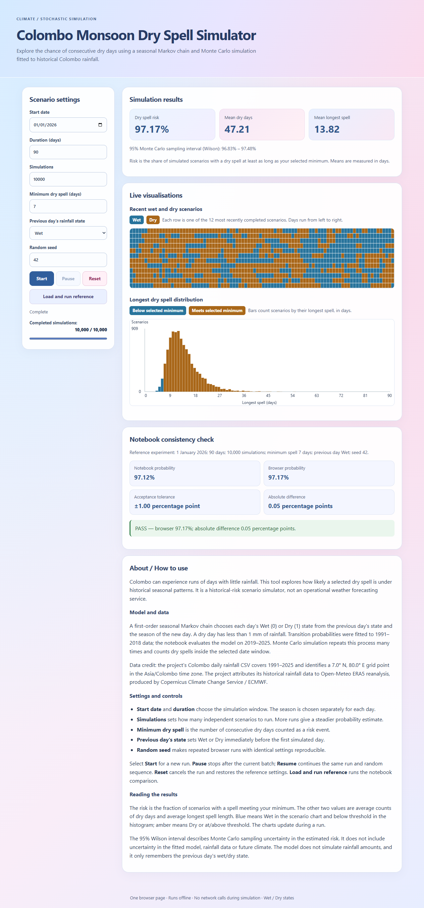
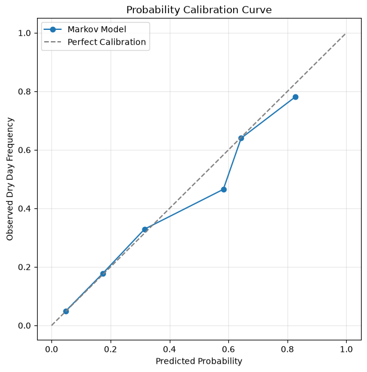

# Colombo Monsoon Dry Spell Simulator

Explore the chance of consecutive dry days near Colombo using a seasonal rainfall model and repeatable browser simulations.

## 2. Live demo and Open in Colab

The Git remote is [NikiniBandara/colombo-monsoon-dry-spell-simulator](https://github.com/NikiniBandara/colombo-monsoon-dry-spell-simulator). The [intended GitHub Pages address](https://NikiniBandara.github.io/colombo-monsoon-dry-spell-simulator/) is **not yet verified as a deployed demo**. You can use the local page now.

[](https://colab.research.google.com/github/NikiniBandara/colombo-monsoon-dry-spell-simulator/blob/main/notebook/colombo-monsoon-dry-spell-simulator.ipynb)

The badge points to the existing notebook. Running it from a fresh Colab runtime has not yet been verified; see [Quick start](#5-quick-start).

## 3. Application screenshot

This is the genuine Chrome capture of a completed reference run of the pastel browser application.



## 4. Problem and research question

Several days with little rain can matter for water planning and other rain-sensitive activities. Rainfall occurrence changes across Sri Lanka's monsoon seasons, so a single year-round dry-day rate can hide important differences.

The research question is: **How likely is the Colombo area to experience a run of consecutive dry days within a selected period, and how does this risk change with monsoon season?** The simulator estimates historical-pattern scenario risk at the dataset's ERA5 grid cell. It does not forecast the weather on specific future dates. The [data guide](data/README.md) explains why the grid cell is not a precise Colombo rain gauge.

## 5. Quick start

1. Clone `https://github.com/NikiniBandara/colombo-monsoon-dry-spell-simulator.git` or download the repository ZIP.
2. Double-click [`docs/index.html`](docs/index.html) in a current browser. Choose settings and select **Start**. The one-page browser simulation needs no server or internet connection after download.
3. To run the scientific notebook locally, install Python and the packages in [`requirements.txt`](requirements.txt):

   ```bash
   python -m pip install -r requirements.txt
   jupyter notebook notebook/colombo-monsoon-dry-spell-simulator.ipynb
   ```

4. Run notebook cells in order. Its relative data and output paths assume the working directory is `notebook/`; set the notebook working directory there before running cells.
5. The Colab badge opens the same notebook. In a fresh Colab runtime, install the listed dependencies and make the repository's `data/`, `models/`, and `results/` paths available relative to `notebook/` before running all cells. A fully verified one-click Colab run is future work.

## 6. User guide

The browser page has six scenario settings, progress controls, live charts and an on-page notebook comparison. See the [user guide](USER_GUIDE.md) for valid ranges and how to read each result.

## 7. Model and mathematics

A day is **Dry (1)** when daily precipitation is below 1 mm, and **Wet (0)** otherwise. A first-order Markov chain uses the previous day's state and the simulated day's season to choose the next state. Its transition probabilities were estimated from 1991–2018 rainfall data. A seeded pseudorandom generator draws the wet/dry states, and Monte Carlo repetitions estimate the chance of a spell at least as long as the chosen minimum. A 95% Wilson interval shows sampling uncertainty in that estimate, conditional on the fitted model. See [THEORY.md](THEORY.md) for equations, parameters and assumptions.

## 8. Verification

The saved notebook reference experiment uses **1 January 2026**, **90 days**, **10,000 runs**, a **7-day minimum spell**, a **Wet previous day**, and **seed 42**. It reports **97.12%** dry spell probability. The JavaScript engine and the tested browser run each give **97.17%**, a difference of **0.05 percentage points**. This is **PASS** against the predetermined **±1 percentage point** tolerance. The browser run also reported **47.21 mean dry days**, **13.82 mean longest-spell days**, and a **96.83%–97.48%** Wilson sampling interval.

These are three different checks: mathematical checks test the simulation rules and limiting cases; cross-implementation consistency compares Python and JavaScript; empirical validation compares model probabilities with held-out historical observations. For X4, an independent check recomputed all four saved transition matrices from the **10,227 training days (1991–2018)** and found an exact match. The seasonal baseline also uses training days only. Earlier exploratory plots show the full 1991–2025 record, so this verifies training-only parameter fitting, not a fully blind model-selection process. The **2,557** held-out days cover 2019–2025; daily scoring uses **2,556** of them, starting **2 January 2019**, because the first test day has no previous state within the test subset. On those scored days, the Brier score is **0.1126** for the Markov model versus **0.1379** for the baseline, with **Brier Skill Score 0.1835**. These are one-day conditional predictions using the observed previous day's state. The plot below is the notebook's saved probability-calibration output.



The application was tested in Chrome through a temporary local static server. Direct `file://` opening was not verified in the available browser environment.

## 9. Concepts Applied

| Concept | Where it is used |
|---|---|
| Discrete-time Markov chains and conditional transition probabilities | A new wet/dry state depends on the previous state and destination-day season. |
| Empirical input modelling | Transition probabilities come from historical state counts. |
| Random variate generation and seeded pseudorandom sampling | Uniform draws select states and make repeated runs reproducible. |
| Monte Carlo simulation and the law of large numbers | Many scenarios estimate dry-spell risk and stabilise sample averages. |
| Statistical confidence intervals | A Wilson interval describes Monte Carlo risk-estimate uncertainty. |
| Historical calibration and chronological holdout validation | Training uses 1991–2018; evaluation uses 2019–2025. |
| Probabilistic model evaluation | Brier score, skill score and a calibration plot assess held-out probabilities. |

## 10. Results, limitations and future work

In the saved **60-day, 10,000-run seasonal-start experiments**, the probability of at least one **7-day** dry spell was **96.01%** from a 1 January start, **38.63%** from 1 March, **0.54%** from 1 May and **13.46%** from 1 October. These starts represent Northeast Monsoon, First Inter-monsoon, Southwest Monsoon and Second Inter-monsoon respectively. The model selects the season for **each simulated date**, so the January window includes 1 March and uses its First Inter-monsoon matrix on that day. These are modelled scenarios, not observed future outcomes. The held-out Brier results above show improvement over the seasonal baseline, while the calibration graph shows how predicted and observed frequencies compare.

The X4 data check found **12,784** complete daily records from 1991–2025. The requested Colombo-area point was **6.9355° N, 79.8487° E**, while the saved ERA5 CSV reports a grid cell at **7.0° N, 80.0° E**. See the [data provenance and licence notes](data/README.md) and [source references](REFERENCES.md); the original retrieval date is not recorded. In the 2019–2025 simulation validation, **three of four** observed summary statistics were inside their simulated 2.5%–97.5% ranges. Average dry-spell length was outside: **3.139 observed days** versus a **3.164–4.109 day** simulated range. The Second Inter-monsoon dry-day frequency was **10.77% observed** versus **15.38% simulated**. These gaps show where the model needs caution.

The model remembers only one previous day, uses fixed season-specific probabilities, and assumes the historical ERA5 grid-cell record is informative for scenarios. It models rainfall occurrence, not intensity, and uses no operational atmospheric forecast. The Wilson interval covers Monte Carlo sampling uncertainty; it does not cover uncertainty in the data, model structure or future climate. Possible future work is higher-order dependence and changing-climate analysis; neither is implemented here.

## 11. Key references

The methods are grounded in [Richardson's stochastic weather-generation paper](https://doi.org/10.1029/WR017i001p00182), [Brier's probability-verification paper](https://doi.org/10.1175/1520-0493%281950%29078%3C0001%3AVOFEIT%3E2.0.CO%3B2), [Wilson's interval paper](https://doi.org/10.1080/01621459.1927.10502953), and [Hersbach and colleagues' ERA5 description](https://doi.org/10.1002/qj.3803). Full citations and primary data/season sources are in [REFERENCES.md](REFERENCES.md).

## 12. AI-assistance note

AI tools assisted with implementation, testing and documentation. The repository includes saved code, model parameters and numerical results so readers can inspect and reproduce the work.

## 13. Licence and data credits

Project source code and original documentation are under the [MIT licence](LICENSE), copyright 2026 Nikini Bandara. Historical rainfall data came from the Open-Meteo Historical Weather API's ERA5 product, which uses Copernicus Climate Change Service information. Data redistribution and attribution terms are described in [data/README.md](data/README.md). The MIT code licence does **not** replace the third-party data licences.
