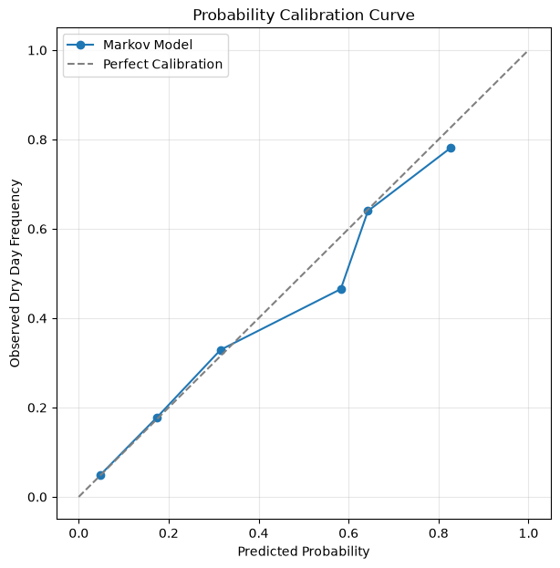

# Theory and mathematics

This document explains the model implemented in the [scientific notebook](notebook/colombo-monsoon-dry-spell-simulator.ipynb) and the [browser code](docs/script.js). It estimates dry-spell risk under historical seasonal rainfall patterns at the dataset's ERA5 grid cell, not a date-specific weather forecast.

## Rainfall classification and notation

Let $R_t$ be daily precipitation in millimetres (mm) on calendar day $t$. The notebook defines the binary state

$$
X_t =
\begin{cases}
1 & R_t < 1\ \mathrm{mm} \quad (\text{Dry}),\\
0 & R_t \ge 1\ \mathrm{mm} \quad (\text{Wet}).
\end{cases}
$$

The threshold is exactly 1 mm. The saved state order is **Wet (0), Dry (1)**. A dry spell is a run of consecutive days with $X_t=1$.

## Seasonal first-order Markov chain

The first-order assumption is

$$
\Pr(X_t=j\mid X_{t-1},X_{t-2},\ldots,s_t)
=\Pr(X_t=j\mid X_{t-1},s_t)
=P^{(s_t)}_{X_{t-1},j},
$$

where $s_t$ is the season of the **destination day** $t$. A matrix row gives the previous state and a column gives the new state:

$$
P^{(s)}=
\begin{pmatrix}
P(\text{Wet}\mid\text{Wet},s)&P(\text{Dry}\mid\text{Wet},s)\\
P(\text{Wet}\mid\text{Dry},s)&P(\text{Dry}\mid\text{Dry},s)
\end{pmatrix}.
$$

The notebook uses Northeast Monsoon in **December–February**, First Inter-monsoon in **March–April**, Southwest Monsoon in **May–September**, and Second Inter-monsoon in **October–November**. Thus a window crossing a season or year boundary changes matrices on the appropriate date. These calendar ranges agree with the [Sri Lanka Journal of Meteorology's rainfall-season description](https://meteo.gov.lk/images/sljom.pdf).

For each season $s$, the training data count consecutive-day transitions $N^{(s)}_{ij}$. The fitted transition probability is

$$
\widehat P^{(s)}_{ij}
=\frac{N^{(s)}_{ij}}{N^{(s)}_{i0}+N^{(s)}_{i1}},
\qquad
\widehat P^{(s)}_{i0}+\widehat P^{(s)}_{i1}=1.
$$

The training window is **1991-01-01 through 2018-12-31**. The fitted parameters are saved in [`models/seasonal_markov_model.json`](models/seasonal_markov_model.json).

## Seasonal transition probabilities

These are the saved model's **full-precision** dry-state probabilities; [`docs/script.js`](docs/script.js) uses the same values. Wet-state probabilities are their complements in each row.

| Destination-day season | $P(\mathrm{Dry}\mid\mathrm{Wet})$ | $P(\mathrm{Dry}\mid\mathrm{Dry})$ |
|---|---:|---:|
| Northeast Monsoon | 0.3008658008658009 | 0.8270911360799001 |
| First Inter-monsoon | 0.17287234042553193 | 0.6431034482758621 |
| Southwest Monsoon | 0.03711034141514102 | 0.371900826446281 |
| Second Inter-monsoon | 0.07844474761255116 | 0.5826446280991735 |

The high Northeast $P(\mathrm{Dry}\mid\mathrm{Dry})$ represents stronger dry-day persistence in this fitted record. The browser values are **not** rounded to eight decimals; any shortened display elsewhere is only for reading.

## Random variate generation

For a simulated day, draw $U_t\sim\mathrm{Uniform}[0,1)$ and use the row corresponding to the previous state:

$$
X_t=\mathbf 1\{U_t<P^{(s_t)}_{X_{t-1},1}\}.
$$

The browser uses a seeded **Mulberry32** pseudorandom generator. The notebook uses NumPy's `default_rng`. The same seed reproduces a run **within** each implementation, but different generators do not produce the same sequences across languages. The reference comparison therefore uses a stated acceptance tolerance, not identical paths.

## Monte Carlo dry-spell simulation

A scenario has start date $d_0$, duration $T$ days, minimum spell $k$ days and previous-day state $X_{-1}$. The initial state describes the day **before** the first simulated date; the first in-window state is drawn from it. Only the $T$ destination days $d_0,\ldots,d_0+T-1$ count. A spell that began outside the window does not carry an existing streak into the window.

For each in-window day, update the current streak $C_t$, maximum streak $L_t$, and dry-day count $D$:

$$
C_t=\begin{cases}C_{t-1}+1,&X_t=1,\\0,&X_t=0,\end{cases}
\qquad L_t=\max(L_{t-1},C_t),\qquad
D=\sum_{t=0}^{T-1}X_t,
$$

with $C_{-1}=L_{-1}=0$. In $N$ independently drawn scenarios, define $H_r=\mathbf 1\{L_r\ge k\}$. The displayed quantities are

$$
\widehat p=\frac{1}{N}\sum_{r=1}^{N}H_r,\qquad
\overline D=\frac{1}{N}\sum_{r=1}^{N}D_r,\qquad
\overline L=\frac{1}{N}\sum_{r=1}^{N}L_r.
$$

The longest-spell histogram has count $h_\ell=\#\{r:L_r=\ell\}$ for $\ell=0,\ldots,T$. It obeys $\sum_\ell h_\ell=N$ and $\sum_{\ell\ge k}h_\ell=\sum_r H_r$. The browser retains only the latest 12 daily sequences for the sample chart; it need not store every simulated path.

## Monte Carlo sampling uncertainty

With $n$ completed runs, $x$ risk events, $\widehat p=x/n$, and $z=1.96$, the browser's 95% Wilson limits are

$$
c=\frac{\widehat p+z^2/(2n)}{1+z^2/n},\qquad
w=\frac{z\sqrt{\widehat p(1-\widehat p)/n+z^2/(4n^2)}}{1+z^2/n},\qquad
[\max(0,c-w),\min(1,c+w)].
$$

This interval measures **Monte Carlo sampling uncertainty conditional on the fitted model**. It does not include uncertainty in the ERA5 data, fitted probabilities, model assumptions or future climate. More runs reduce sampling noise; they do not remove those other uncertainties.

## Calibration and empirical validation

The source is daily ERA5 precipitation for **1991–2025** delivered through Open-Meteo; its requested location, returned grid cell, [CC BY 4.0 provider terms](https://open-meteo.com/en/license) and [Copernicus attribution terms](https://cds.climate.copernicus.eu/licences/licence-to-use-copernicus-products) are detailed in [data/README.md](data/README.md). Its **12,784** daily values are complete and nonnegative. The cleaned values match the source after renaming columns and parsing dates. The model is trained through 2018 and tested on the later period **2019-01-01 through 2025-12-31**. The original source retrieval date is not recorded.

The **10,227** training rows end on 2018-12-31. The notebook computes next-day states and destination-day seasons *after* selecting those rows, giving **10,226** training transitions. An independent count-based recalculation matches every saved seasonal matrix entry exactly. The baseline is the training-only mean dry-day rate for each season, with no test-period counts used to fit it. The **2,557** test rows are disjoint from the training rows. Earlier exploratory plots and summaries use the full record, however, so the test years were visible during exploration; the audit establishes no fitted-parameter leakage, not fully blind model selection. Daily evaluation uses the observed previous-day state to make a conditional one-day prediction; it does not update model parameters using test outcomes. Since that previous state is formed within the test subset, the first day is dropped. Thus daily Brier scoring covers **2,556** dates from **2019-01-02 to 2025-12-31**. The saved summary's 2019-01-01 start denotes the full holdout period, not the first scored date.

For held-out observed state $y_i\in\{0,1\}$ and predicted dry probability $q_i$, the Brier score and Brier Skill Score are

$$
\mathrm{BS}=\frac{1}{m}\sum_{i=1}^{m}(q_i-y_i)^2,\qquad
\mathrm{BSS}=1-\frac{\mathrm{BS}_{\rm Markov}}{\mathrm{BS}_{\rm baseline}}.
$$

Lower Brier score is better; BSS above zero improves on the baseline. The saved [evaluation summary](results/evaluation_summary.json) gives **0.1125865** (Markov), **0.1378854** (baseline), and **0.1834775** BSS, or about **18.35%** relative improvement. The notebook's [calibration plot](figures/calibration.png) groups held-out probabilities and compares mean predicted probabilities with observed dry frequencies. The curve is not perfectly calibrated. This is empirical evaluation, distinct from checking the simulator code.

The saved [seasonal evaluation](results/seasonal_model_evaluation.csv) has positive Brier Skill Scores for all four seasons: **0.2080** Northeast, **0.2180** First Inter-monsoon, **0.0928** Southwest and **0.1490** Second Inter-monsoon. In the separate **1,000-path** [simulation validation](results/simulation_validation.csv), three of four observed statistics fall inside their simulated 2.5%–97.5% ranges. Average dry-spell length does not: **3.139** observed days, below the simulated **3.164–4.109** range. The [seasonal dry-frequency comparison](results/seasonal_simulation_validation.csv) shows **10.77%** observed versus **15.38%** simulated in Second Inter-monsoon. These mismatches remain visible; a positive Brier Skill Score does not mean every spell statistic is reproduced.

## Verification

The saved notebook reference uses **2026-01-01**, **90 days**, **10,000 replications**, $k=7$, previous state Wet and seed 42. The notebook reports **97.12%** risk; the JavaScript engine and the tested Chrome run report **97.17%**. Their difference is **0.05 percentage points**, so the check passes the predetermined **±1 percentage point** tolerance. Browser means are **47.21 dry days** and **13.82 longest-spell days**; the Wilson interval is **96.83%–97.48%**.

Browser verification also checked seeded repeatability, one-day and 1/366-day threshold boundaries, leap years and year changes, always-wet and always-dry limiting cases, histogram frequency and risk-count conservation, confidence-interval bounds, and pause/resume reproducibility. Actual Chrome interaction was checked through a temporary static server; direct `file://` opening was not verified in that browser environment. A consistency check is not proof that future rainfall follows this model.

The notebook's dynamic program independently computes the exact probability of a dry spell under the fitted matrices. For the 90-day reference scenario with a 7-day threshold, it gives **0.970421256645**; the 10,000-run Monte Carlo estimate is **0.9712**. It also checks manually calculable cases and compares exact and simulated risks for 15 existing scenarios. A separate eight-seed experiment found a measured log–log RMSE slope of **−0.395**, compared with the theoretical **−0.500** from the $N^{-1/2}$ rate; finite-seed estimates can fluctuate. See [the convergence graph](figures/monte_carlo_convergence.png).

## Controlled sensitivity analysis

The notebook's sensitivity study changes one input at a time, with **10,000 runs and seed 42** for each setting. It reuses the existing seasonal, spell-duration and reference experiments where possible. The [full results table](results/sensitivity_analysis.csv) records the configuration, event count, risk and 95% Wilson interval for every setting. The [sensitivity graph](figures/sensitivity_analysis.png) shows the same intervals.

| Changed input | Controlled comparison | Observed dry-spell risks |
|---|---|---|
| Simulation horizon | Jan 1 start, 7+ days, previous day wet | 30/60/90/120 days: **76.83% / 96.01% / 97.12% / 97.88%** |
| Starting season | 60 days, 7+ days, previous day wet | Jan/Mar/May/Oct starts: **96.01% / 38.63% / 0.54% / 13.46%** |
| Minimum spell duration | Jan 1 start, 90 days, previous day wet | 7+/14+/21+ days: **97.12% / 44.60% / 11.41%** |
| Previous-day state | Jan 1 start, 90 days, 7+ days | Wet/Dry: **97.12% / 97.46%** |

Within these selected settings, starting date and required spell length make the largest changes. A longer window also raises the chance of an event. The previous-day state produces a smaller **0.34 percentage point** difference here; its two Wilson intervals overlap, so these separate intervals alone do not establish a clear difference. A 60-day window may cross a season boundary, and the destination day's matrix is used throughout. The intervals describe simulation sampling error under the fitted model, not uncertainty in its historical estimates or future climate.

## Assumptions, complexity and limitations

Each replication uses $T$ state draws and constant work per day, so simulation time is $O(NT)$. The browser's histogram uses $O(T)$ counts, its calendar probability array uses $O(T)$ values, and its rolling chart holds at most 12 sequences of $T$ states.

The first-order model can miss longer memory; probabilities are fixed within each season and across years. The ERA5 grid cell is not a Colombo station measurement. Rainfall is reduced to occurrence below/above 1 mm, so amounts and atmospheric causes are absent. The application is a historical-risk scenario simulator, not an operational weather forecasting service. Higher-order models, rainfall-intensity models and changing-climate studies remain future work.

## References

See [REFERENCES.md](REFERENCES.md) for verified scientific and data sources.
