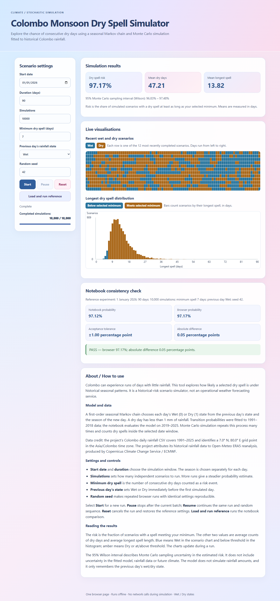

# User guide: Colombo Monsoon Dry Spell Simulator

The simulator is one browser page. Use the [live GitHub Pages demo](https://NikiniBandara.github.io/colombo-monsoon-dry-spell-simulator/) or download the repository and double-click [`docs/index.html`](docs/index.html). The hosted page returned HTTP 200 during this audit. The downloaded page is designed to run without a server or network connection, but direct `file://` opening has not been independently verified. A current Chrome, Edge or Firefox browser is suitable.

## Scenario settings

| Setting on the page | What it means | Valid input | Default |
|---|---|---|---|
| Start date | First simulated calendar day; the season is chosen again for each following day. | 1900-01-01 to 2100-12-31 | 2026-01-01 |
| Duration (days) | Number of days in each simulated window. | Whole number, 1–366 | 90 |
| Simulations | Number of independently generated scenarios. | Whole number, 1–50,000 | 10,000 |
| Minimum dry spell (days) | Consecutive dry days required for a risk event. | Whole number, 1 through the chosen duration | 7 |
| Previous day's rainfall state | Wet or Dry immediately **before** the start date. | Wet (0) or Dry (1) | Wet |
| Random seed | Starts the browser's pseudorandom sequence. | Whole number, 0–4,294,967,295 | 42 |

A **dry day** has less than 1 mm of rainfall. A **wet day** has at least 1 mm. The start date and duration define the window; a previous-day Dry choice does not pre-count an earlier dry streak. The form rejects missing, out-of-range and non-whole-number values, and rejects a minimum spell longer than the duration.

## Run controls and progress

1. Change any settings and select **Start**. This starts a new run. Completed simulations, a progress bar, results and charts update in batches.
2. Select **Pause** to stop after the current batch. The **Start** button changes to **Resume**. Select **Resume** to continue the same run, including its random-generator state. Settings remain locked during this run.
3. Select **Reset** to cancel the run, clear results and restore all six default settings.
4. Select **Load and run reference** to restore the reference settings and start their comparison with the notebook. Wait until all 10,000 simulations finish to read the final PASS/FAIL message.

After any complete run, selecting **Start** begins a new run with the selected settings. A repeated run with the same browser settings and seed gives the same browser result.

## Read the results

- **Dry spell risk:** percentage of completed scenarios with at least one spell meeting the chosen minimum duration. It is a model-based scenario estimate.
- **Mean dry days:** average number of Dry days within each simulated window, measured in days.
- **Mean longest spell:** average longest consecutive Dry run within each window, measured in days.
- **95% Monte Carlo sampling interval (Wilson):** range for the simulation's estimated risk from the current number of runs, conditional on this fitted model. It does **not** include uncertainty about the rainfall dataset, model choice or future climate.

The wet/dry scenario chart shows the **12 most recently completed** sequences, one row per scenario and time from left to right. **Blue is Wet; amber is Dry.** The longest-spell histogram groups scenarios by their longest dry run in days. **Blue bars are below** the selected minimum and **amber bars meet or exceed** it. Bar height is the number of scenarios. Both charts update while a run is active.

## Notebook consistency check

The reference experiment uses **2026-01-01**, **90 days**, **10,000 simulations**, a **7-day** minimum, previous day **Wet**, and seed **42**. The saved Python notebook reports **97.12%** risk. The tested browser application gave **97.17%**, an absolute difference of **0.05 percentage points** and **PASS** against the predetermined **±1 percentage point** tolerance. The tested browser also gave **47.21** mean dry days, **13.82** mean longest-spell days and a **96.83%–97.48%** Wilson interval.

The on-page check compares only a **completed run with all six reference settings**. It shows PASS when the absolute probability difference is at most one percentage point and FAIL otherwise. It does not judge a custom scenario. Python and JavaScript use different random-number generators, so individual daily paths need not match.

## Try a scenario

Keep the defaults, choose **Load and run reference**, and watch the risk and charts change as the completed count rises. Then select **Reset**, change the start date to **2026-06-01**, keep a 90-day duration and 7-day minimum, and select **Start**. Compare the new risk with the reference result: this window is mainly in Southwest Monsoon. Its numerical outcome is deliberately left to the simulation.

## Limits of interpretation

The app is a historical-risk **scenario simulator**, not an operational weather forecast. It uses a seasonal first-order wet/dry Markov model trained on **1991–2018** ERA5-grid-cell rainfall, and the notebook tests it on **2019–2025**. It does not generate rainfall amounts, atmospheric predictions or precise rain-gauge measurements for Colombo. Model parameters are fixed by season. See [THEORY.md](THEORY.md) for mathematics and [data/README.md](data/README.md) for location and data credits.

The application was tested in Chrome through a temporary local static server. Direct `file://` opening was not verified in the available browser environment; if the downloaded file behaves differently in your browser, record the browser and any console error for investigation.
